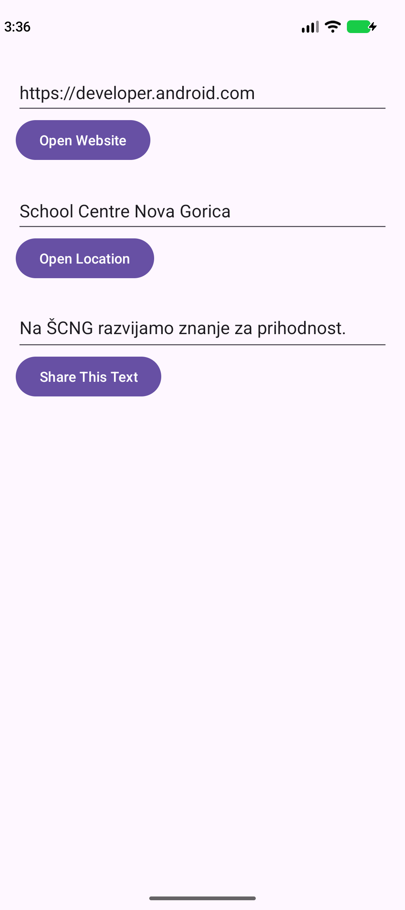
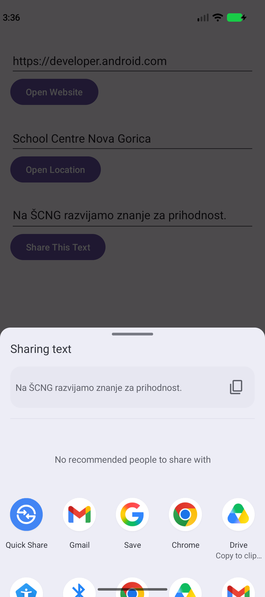
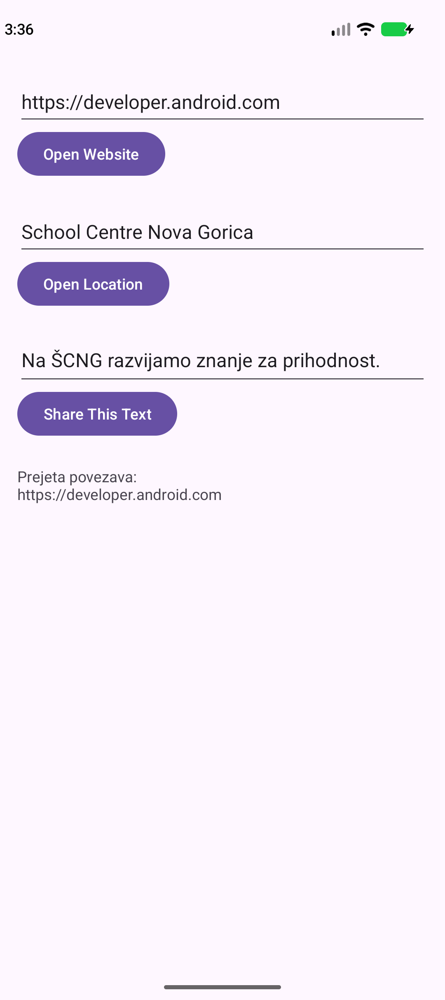

# Implicit Intents

An Android application demonstrating how implicit intents open web pages, find locations on a map, and share text with other applications. Created for assignment 6 in the mobile application development course (MOAp).

## Features

- **Open Website** — opens an HTTP or HTTPS address in a compatible application. Adds `https://` when the scheme is omitted.
- **Open Location** — searches for a place or address in a map application using a `geo:0,0?q=...` URI.
- **Share This Text** — opens the Android share chooser using `ShareCompat.IntentBuilder` and the `text/plain` MIME type.
- **Receive links** — declares an intent filter for HTTP and HTTPS links to `developer.android.com` and displays the received URI. Opening these links in the app depends on the device's link-handling settings; domain verification is disabled.
- **Input validation** — reports empty fields, invalid website addresses, and missing compatible applications.
- **Scrollable layout** — keeps the form accessible on smaller screens and when the keyboard is visible.

## Posnetki zaslona

Dejanski posnetki aplikacije, zajeti na emulatorju **Pixel_10**.

| Glavni zaslon | Deljenje besedila | Prejeta povezava |
| --- | --- | --- |
|  |  |  |

Prikaz prejete povezave je bil preizkušen z neposrednim zagonom aktivnosti z akcijo `VIEW` in podatkovnim URI-jem. Samodejno odpiranje spletnih povezav v aplikaciji je odvisno od nastavitev Androida.

## Technologies

- Java
- Android XML layouts and string resources
- AndroidX AppCompat and Core (`ShareCompat`)
- Material Components
- Gradle Kotlin DSL with the included Gradle Wrapper

## Requirements

- Android Studio compatible with the project's Android Gradle Plugin version (see `gradle/libs.versions.toml`).
- Android SDK Platform 37.
- JDK 25 for the Gradle daemon, as configured in `gradle/gradle-daemon-jvm.properties`. Java source and target compatibility are set to Java 11.
- An emulator or Android device with API level 24 or higher.
- A browser, map application, and a text-sharing application to try all features.

## Run in Android Studio

1. Clone or download this repository.
2. Open the repository folder in Android Studio.
3. Let Gradle sync and install any requested SDK components.
4. Check the local Android SDK location in Android Studio. The machine-specific `local.properties` file should not be committed.
5. Select an emulator or connect a device with USB debugging enabled.
6. Run the **app** configuration.

## Build from the command line

Set `JAVA_HOME` to a suitable JDK before running the wrapper.

On Windows (PowerShell):

```powershell
.\gradlew.bat :app:assembleDebug
```

On macOS or Linux:

```bash
chmod +x gradlew
./gradlew :app:assembleDebug
```

The debug APK is generated at:

```text
app/build/outputs/apk/debug/app-debug.apk
```

Run Android Lint with:

```powershell
.\gradlew.bat :app:lintDebug
```

## Try it out

| Action | Example input | Expected result |
| --- | --- | --- |
| Open Website | `https://developer.android.com` | Opens the website in a compatible app. |
| Open Website | `example.com` | Opens `https://example.com`. |
| Open Location | `School Centre Nova Gorica` | Searches for the location in a map app. |
| Share This Text | `Na ŠCNG razvijamo znanje za prihodnost.` | Opens the share chooser with the entered text. |
| Any action | Empty input | Displays an error on the input field. |
| Open Website | `ftp://example.com` | Reports an invalid website address. |

Map and website actions require compatible applications on the device. Network access is handled by the receiving applications.

## Project structure

```text
app/src/main/
├── AndroidManifest.xml                 # Launcher, link filter and visibility queries
├── java/com/example/implicitintents/
│   └── MainActivity.java               # Input validation and intent handling
└── res/
    ├── layout/activity_main.xml        # Three input fields and action buttons
    └── values/strings.xml              # Labels, example inputs and messages
```

## Implementation notes

Website and map actions use `Intent.ACTION_VIEW` and check `resolveActivity()` before launching. The manifest includes `<queries>` entries for HTTP, HTTPS and geo handlers so these checks work with Android package visibility restrictions. Location queries are encoded with `Uri.encode()` to preserve spaces and special characters.

The app does not request location access: it passes the entered search text to a map application. It also does not request the `INTERNET` permission because web pages are opened by another application.

## Validation

The debug build (`assembleDebug`) and Android Lint (`lintDebug`) completed successfully during development. The main screen, Android share chooser and received-URI display were also checked on the Pixel_10 emulator. Opening websites in a browser and searching in a map application have not yet been interactively verified.

## Odgovori na vprašanja (naloga 6)

### 1. Kaj najbolje opiše implicitni namen?

**Pravilen odgovor: b.** Določimo dejanje, ki ga želimo izvesti, ne določimo pa točno določene aktivnosti ali aplikacije. Android poišče ustrezne prejemnike glede na dejanje, podatke in filtre namenov.

### 2. Katero akcijo uporabimo za spletno stran in lokacijo na zemljevidu?

**Pravilen odgovor: c — `Intent.ACTION_VIEW`.** Pri spletni strani podamo spletni URI, pri lokaciji pa URI s shemo `geo`.

### 3. Kateri zapis pravilno pretvori lokacijo v URI?

**Pravilen odgovor: b — `Uri.parse("geo:0,0?q=" + loc)`.** V aplikaciji lokacijo dodatno kodiramo, da pravilno obravnavamo presledke, šumnike in posebne znake:

```java
Uri uri = Uri.parse("geo:0,0?q=" + Uri.encode(loc));
```

### 4. Zakaj uporabimo `resolveActivity(getPackageManager())`?

**Pravilen odgovor: a.** Preverimo, ali sistem najde aktivnost, ki lahko obdeluje podani implicitni namen. Če je rezultat `null`, uporabniku prikažemo obvestilo namesto zagona aktivnosti.

Pri Androidu 11 in novejših moramo pri takšnem preverjanju upoštevati omejeno vidnost aplikacij. Zato projekt v manifestu vključuje ustrezne vnose `<queries>`.

### 5. Kateri MIME tip uporabimo za deljenje besedila?

**Pravilen odgovor: b — `text/plain`.** Označuje navadno besedilo.

### 6. Kateri razred poenostavi izdelavo namena za deljenje?

**Pravilen odgovor: a — `ShareCompat.IntentBuilder`.** Z njim nastavimo vrsto vsebine in besedilo ter odpremo sistemsko okno za izbiro aplikacije:

```java
new ShareCompat.IntentBuilder(this)
        .setType("text/plain")
        .setText(text)
        .startChooser();
```

### 7. Kaj mora vsebovati filter za sprejem povezave do `developer.android.com`?

**Pravilen odgovor: a.** Potrebujemo akcijo `VIEW`, kategoriji `DEFAULT` in `BROWSABLE` ter podatkovni filter s shemo `http` in gostiteljem `developer.android.com`. Projekt podpira tudi shemo `https`:

```xml
<intent-filter android:autoVerify="false">
    <action android:name="android.intent.action.VIEW" />
    <category android:name="android.intent.category.DEFAULT" />
    <category android:name="android.intent.category.BROWSABLE" />
    <data android:scheme="http" />
    <data android:scheme="https" />
    <data android:host="developer.android.com" />
</intent-filter>
```

Ta filter določa sprejem povezav. Vnosi `<queries>` imajo drugo nalogo: omogočajo preverjanje ustreznih zunanjih aplikacij. Ker domena ni preverjena, filter sam ne zagotavlja samodejnega odpiranja povezav v tej aplikaciji.

### 8. Kako pridobimo in prikažemo prejeti URI?

**Pravilen odgovor: a.** Z `getIntent()` pridobimo vhodni namen, z `getData()` preberemo URI in ga prikažemo v gradniku `TextView`. Preverimo tudi, ali je URI prisoten:

```java
Intent intent = getIntent();
Uri uri = intent.getData();
if (Intent.ACTION_VIEW.equals(intent.getAction()) && uri != null) {
    TextView receivedUri = findViewById(R.id.received_uri);
    receivedUri.setText(uri.toString());
    receivedUri.setVisibility(View.VISIBLE);
}
```

### Viri

- Učni list: *Razvoj mobilnih aplikacij – Naloga 6: Delo z implicitnimi nameni*.
- [Android Developers: Intents and intent filters](https://developer.android.com/guide/components/intents-filters)
- [Android Developers: ShareCompat.IntentBuilder](https://developer.android.com/reference/androidx/core/app/ShareCompat.IntentBuilder)
- [Android Developers: Package visibility use cases](https://developer.android.com/training/package-visibility/use-cases)
